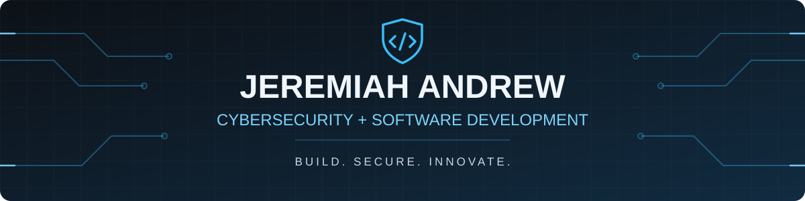

# Hi, I'm Jeremiah Andrew 👋

**Cybersecurity Enthusiast | Software Developer | B.Tech CSE (Cyber Security)**

Building software with security in mind.

## About Me

I'm a B.Tech Computer Science and Engineering student specializing in Cyber Security. I enjoy exploring how systems work, identifying security weaknesses in authorized lab environments, and building practical software solutions.

- **Cybersecurity:** Vulnerability assessment, penetration testing, network security and web application security.
- **Software development:** Full-stack applications, REST APIs, databases and secure authentication.
- **Currently learning:** Secure coding, security automation and practical software engineering.
- **Goal:** Develop reliable applications and strengthen their security from the ground up.

## Tech Stack & Tools

Technologies I have explored through projects, coursework and hands-on labs:

### Languages

### Software Development

### Cybersecurity & Lab Tools

## Featured Projects

### [NetSentinel — Network Security Inventory](https://github.com/jeremiahandrew033/NetSentinel)

A local security lab dashboard combining a React/TypeScript frontend, FastAPI backend, optional loopback-only Nmap scanning, simulated demo data, SQLite scan history and JSON reports. Initial prototype; automated checks are configured.

**Technologies:** Python, FastAPI, React, TypeScript, Nmap, SQLite.

### [SIH-26128 — AI-Enabled Livestock Health Platform](https://github.com/jeremiahandrew033/SIH-26128)

A multidisciplinary project for livestock health surveillance and disease management. The repository combines an AI health scanner with a web platform for farmers, veterinary officers and government users.

**Project technologies:** React, TypeScript, FastAPI, Python, Supabase and computer vision.

**Areas of interest:** Role-based access, authentication, API integration and AI-assisted health screening.

[Explore the repository](https://github.com/jeremiahandrew033/SIH-26128) · [Platform documentation](https://github.com/jeremiahandrew033/SIH-26128/tree/main/livestock-health-platform)

## What I'm Working Toward

- Publishing documented cybersecurity lab experiments.
- Building Python-based security automation projects.
- Developing secure full-stack applications.
- Improving my understanding of application and network security.

## GitHub Activity

## Contribution Snake

<picture>
  <source media="(prefers-color-scheme: dark)" srcset="https://raw.githubusercontent.com/jeremiahandrew033/jeremiahandrew033/output/github-contribution-grid-snake-dark.svg">
  <source media="(prefers-color-scheme: light)" srcset="https://raw.githubusercontent.com/jeremiahandrew033/jeremiahandrew033/output/github-contribution-grid-snake.svg">
  
</picture>

## Connect

[Explore my GitHub profile](https://github.com/jeremiahandrew033) or browse my repositories to follow my learning and project work.

---

**Build. Secure. Innovate.**

